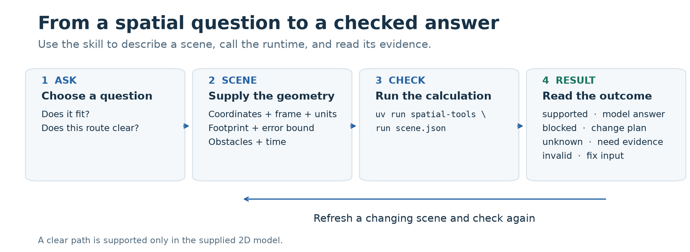
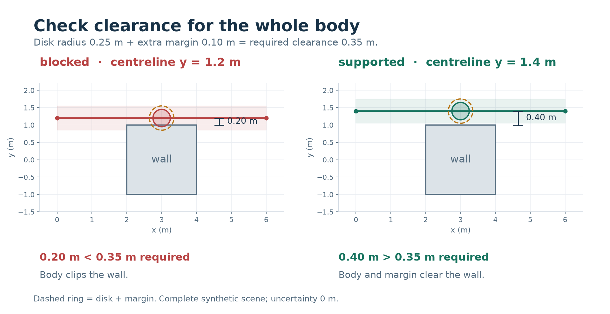
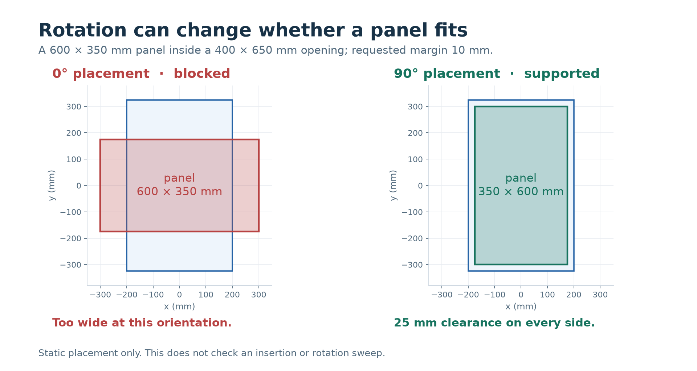
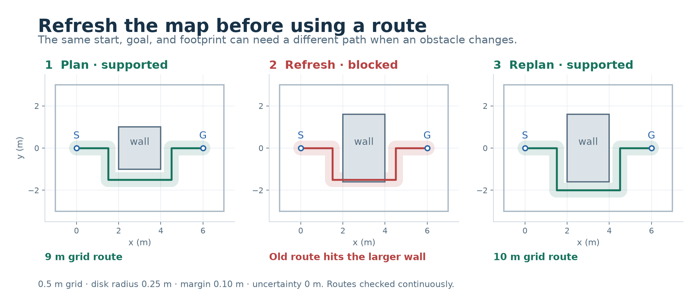

# Use spatial-tools with visual examples

Choose a spatial question, describe the relevant geometry, and use the result to
decide the next step. The pictures below come from executable synthetic scenes;
distances, shapes, and routes match the runtime's answers.



From the repository root, run `uv sync --locked` once. For an installed skill,
start a request with `Use $spatial-reasoning to…` and provide the scene. These
examples use an explicit replay clock so their synthetic observations stay
reproducible. For live work use the actual observation timestamp and omit
`as_of`; the runtime checks it against UTC now.

## Include the body's footprint and margin



The wall spans `[2,-1]` to `[4,1]` in metres. Both proposed centrelines stay above
the wall, but the disk has radius **0.25 m** and needs **0.10 m** extra clearance.
Its centreline must stay more than **0.35 m** away, allowing the reported numerical
tolerance. With zero uncertainty, the two paths differ as follows:

| Request | Centreline | Nearest wall clearance | Outcome |
|---|---|---|---|
| [narrow-path.json](../examples/narrow-path.json) | `y = 1.2 m` | `0.20 m` | `blocked` |
| [clear-path.json](../examples/clear-path.json) | `y = 1.4 m` | `0.40 m` | `supported` |

```sh
uv run spatial-tools run examples/narrow-path.json
uv run spatial-tools run examples/clear-path.json
```

The first command deliberately exits **2** and still prints JSON. Inspect
`result.blocked_by`, `minimum_obstacle_clearance`, and `required_clearance`.
The whole polyline is checked, including the segments between waypoints.

Suggested skill request:

> Use $spatial-reasoning to check whether this 0.25 m radius disk can follow the
> supplied path with 0.10 m extra clearance. Use the map's metre coordinates,
> completeness, timestamp, and error bound.

## Check a rotated static placement



The blue shape is the **400 × 650 mm** opening. The panel is **600 × 350 mm**.
At its original orientation it is too wide; rotating it **90° about its centroid**
gives a **350 × 600 mm** placement with **25 mm** on every side. That exceeds
the requested **10 mm** margin.

```sh
uv run spatial-tools run examples/unrotated-fit.json
uv run spatial-tools run examples/rotated-fit.json
```

The first returns `blocked`; the second returns `supported` with
`result.boundary_clearance: 25`. The query names the `item` and `container`,
sets `rotation_degrees`, and supplies its margin in the scene's millimetres.
This is a static placement check. To establish an insertion or rotation sweep,
use a tool that checks that motion as well.

Suggested skill request:

> Use $spatial-reasoning to check the panel at 0° and 90° in this opening,
> requiring 10 mm clearance. Explain which static placements fit.

## Refresh the map and replan



`S` and `G` are the same start and goal in all three panels. The shaded band
shows the disk plus margin along the route. The first route is **9 m** long.
When the wall grows, the old route is blocked. Refreshing the scene and planning
again produces a **10 m** route with continuous clearance checks.

```sh
uv run spatial-tools run examples/plan-route.json
uv run python scripts/pilot.py
```

The pilot records all five checks: plan, validate the route, refresh the changed
map and reject the old route, replan, and validate the new route. Inspect its
requests and results in `eval-runs/runtime-pilot/`. The planner uses a **0.5 m**
four-connected grid here. Its shortest route applies to that grid; a continuous
route could differ.

Suggested skill request:

> Use $spatial-reasoning to find a route through this map for the stated footprint.
> If the map changes, refresh the scene and check the route again before use.

## Read the evidence before using an answer

These pictures use a complete obstacle map, an explicit Cartesian frame, known
units, zero coordinate uncertainty, and a replayed observation time. Supply the
corresponding facts for your own task. Unknown uncertainty, incomplete obstacle
coverage, or stale observations return `unknown`. Unsupported fields, mixed units
or frames, and invalid geometry return `invalid`.

A `supported` relation can have a false value; read the result as well as its
status. For a path or fit, support applies to the supplied 2D model. An existing
controller handles authorized actions and the next observation.

See the [scene contract](scene-contract.md) for the full input format and
[evaluation](evaluation.md) for the checks behind these examples. The
[image sources and downloads](images/README.md) include editable SVGs and PNGs.
